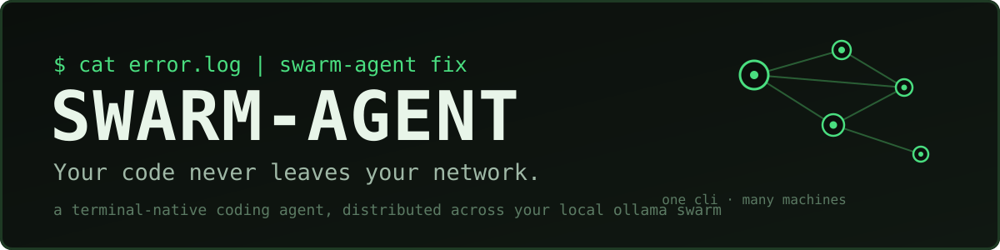
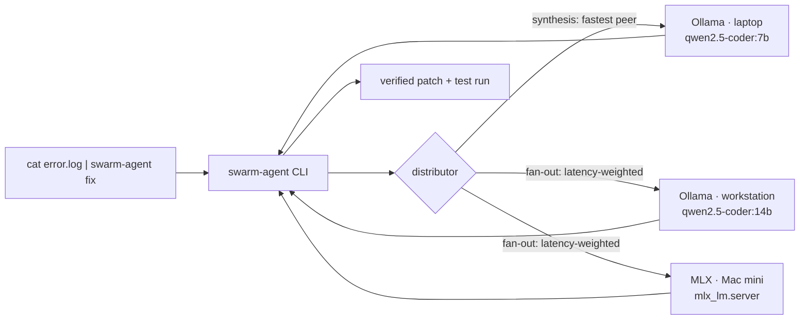

<p align="center">
  
</p>

<p align="center">
  
  
  
  
  
  
  
</p>

**A terminal-native coding agent that runs on machines you own.** Ask it to
fix a crash, analyse a repository, or draft a test suite — and instead of
sending your code to someone else's cloud, it splits the work across the
Ollama instances already running on your local network: your laptop, the
workstation under the desk, the Mac mini in the corner. One CLI, many
machines, zero uploads.

## Why

AI coding assistants are genuinely useful, and a lot of developers still
can't use them: the code is proprietary, the client contract says no, the
repo *is* the company. Every cloud assistant wants your source on their
servers.

Meanwhile, most teams already own plenty of compute. It just sits idle in
individual machines, one Ollama at a time — and a single laptop chokes on
the jobs that matter most: analysing a massive codebase chunk by chunk, or
generating tests for a whole tree.

swarm-agent's answer is to treat your LAN as the computer:

- **Privacy by construction.** Inference happens on peers you run. There is
  no cloud endpoint in the design — no account, no API key, no telemetry.
- **The swarm does the heavy lifting.** Repository analysis is fanned out
  chunk-by-chunk across every peer, scheduled by measured latency (an
  EWMA of real unit timings, so faster peers naturally take more), with
  automatic failover when a machine drops off.
- **Hardware you already paid for.** Ollama anywhere; MLX on Apple Silicon,
  where unified memory lets big coder models chew through big context.

## How it works



### How a fix flows

1. You pipe a crash log in. swarm-agent extracts the file paths and line
   numbers from the traceback and pulls those files as context — then it
   goes looking further: a persistent repo index (see below) ranks chunks
   from *other* files by relevance to the error, and the best of them join
   the prompt as labelled related context, because the root cause often
   lives in a file the traceback never names.
2. The fastest peer gets one synthesis prompt: *error + code → a unified
   diff, nothing else* (the prompts are written bluntly, the way
   Qwen2.5-Coder-class models like them). The contract is selected by
   language — the deepest traceback file's extension picks the Python,
   JavaScript, TypeScript, Go or Rust variant — and a fix may span
   several files in a single diff.
3. The diff comes back to **your** machine, where the patcher verifies
   every hunk's context in *every* file against the current files *before
   writing anything*. Verification is all-or-nothing across files: a
   stale diff is an error message, never a half-patched tree.
4. With `--apply`, the patch lands and the project's test suite runs —
   the command is auto-detected from the repo (`npm test`, `go test
   ./...`, `cargo test`, pytest) unless you overrode it. If tests fail,
   the failure output is parsed into structured records
   (`{file, test, message}`) and the swarm re-diagnoses from them:
   original error + previous diff + exactly which tests failed and why.
   Repairs are bounded (`SWARM_MAX_REPAIRS`, default 2) and each attempt
   is verified against the current file state before the next runs.

Analysis inverts the shape: hundreds of small per-chunk summaries are the
fan-out, and a single synthesis call on the fastest peer merges them into
the report.

## Quickstart

```bash
# 1. Install (stdlib-only — nothing else to fetch)
git clone <this repo> && cd swarm-agent
pip install -e .

# 2. Start a model server on this machine (or any machine on your LAN)
ollama pull qwen2.5-coder:7b
ollama serve

# 3. Check the machine and the swarm
swarm-agent doctor
swarm-agent swarm --scan        # find every Ollama on your /24

# 4. Use it
cat error.log | swarm-agent fix
```

## Usage

### `fix` — from crash log to verified patch

```console
$ cat error.log | swarm-agent fix --apply
swarm-agent: context from 1 file(s): calc.py
swarm-agent: applied changes to calc.py
swarm-agent: tests pass (python -m pytest -q)
```

Without `--apply` it's a dry run: you get the proposed diff, plus a check
that it would apply cleanly. The classic zsh workflow just works:

```bash
python app.py 2>&1 | swarm-agent fix            # propose
python app.py 2>&1 | swarm-agent fix --apply    # apply + run tests
swarm-agent fix --file crash.txt --path ~/code/myrepo
```

### `analyze` — a whole repo, read by the whole swarm

```bash
swarm-agent analyze ~/code/bigrepo
swarm-agent analyze . --question "where is retry logic implemented, and is it safe?"
```

Files are walked (skipping `.git`, venvs, `node_modules`, binaries and
anything over 1 MB), chunked code-aware, summarised in parallel across
your peers, and merged into a structured report: purpose, architecture,
key modules, risks, suggested next steps.

### `gen-tests` — draft a test suite for a module

The contract follows the target's extension: pytest for Python, jest for
JavaScript/TypeScript, `go test` for Go, `cargo test` for Rust (unknown
extensions fall back to the Python contract).

```bash
swarm-agent gen-tests src/pricing.py            # print the suite
swarm-agent gen-tests src/pricing.py --write --run
# wrote tests/test_pricing_generated.py, and ran it
```

With `--write`, JS targets land as `tests/<name>.test.js` and TS targets
as `tests/<name>.test.ts`. Honest limitation: Go and Rust suites still
use the legacy `tests/test_<name>_generated.py` path — idiomatic
placement (in-package `_test.go`, inline `mod tests`) doesn't fit this
flow's single write step yet. With `--run`, non-Python suites run via
the repo's detected test command, not pytest.

### The persistent repo index

There is no separate index command to run: `fix` builds or refreshes the
index itself, every time. Chunk embeddings are computed once and stored
in `<repo>/.swarm/index.json`, then reused until a file's mtime or size
changes — only changed files are re-chunked and re-embedded, and deleted
files drop out. Embeddings come from an Ollama peer (`/api/embed`) when
one answers; when none does, the index falls back to a local TF-IDF
embedder so retrieval still works fully offline. If the index can't be
built or searched, `fix` prints a note and continues without related
context — retrieval is a hint, never a single point of failure.

### `ask`, `swarm`, `doctor`

```bash
swarm-agent ask "why would a dict lose insertion order in a pickle round-trip?"
swarm-agent swarm            # peers, models, latency
swarm-agent doctor           # hardware report + backend recommendations
```

`swarm --scan` looks beyond the configured peers: it scans the local /24
for Ollama on port 11434 and also browses mDNS (DNS-SD) for advertised
services. One honest caveat — stock Ollama does **not** advertise itself
over mDNS, so that channel mainly finds wrapped or third-party services
that publish `_ollama._tcp`; the subnet scan remains the workhorse.

Exit codes are script-friendly: `0` success, `1` the swarm or workflow
failed, `2` bad usage.

## Add a machine to your swarm

Any computer on your network can become a peer in about a minute:

```bash
# on the new machine
ollama pull qwen2.5-coder:7b
OLLAMA_HOST=0.0.0.0:11434 ollama serve
```

```bash
# on yours — pick it up in the scan, or name it explicitly
swarm-agent swarm --scan
export SWARM_PEERS="http://localhost:11434,http://192.168.1.40:11434"
```

> **Firewall note:** binding Ollama to `0.0.0.0` serves *anyone on the
> network* who can reach port 11434, with no auth. Do this on networks
> you trust, keep your host firewall on, and don't port-forward it. Your
> code stays on the LAN — make sure the LAN deserves it.

Persistent setup lives in `~/.config/swarm-agent/config.json`:

```json
{
  "model": "qwen2.5-coder:7b",
  "peers": ["http://localhost:11434", "http://192.168.1.40:11434"],
  "test_command": "python -m pytest -q"
}
```

## Apple Silicon: MLX and unified memory

A Mac is often the best seat in the swarm. Ollama already uses Metal, and
for serving a dedicated coder model, `mlx_lm.server` is frequently faster
still — swarm-agent speaks to it as a first-class **MLX peer**
(OpenAI-compatible API, auto-detected on `localhost:8080`, or set
`mlx_url` / `SWARM_MLX_URL`).

Unified memory is the reason this works so well: the model lives in one
pool that CPU and GPU share, so size is mostly a question of gigabytes:

| Unified memory | Comfortable coder model | Notes |
|---|---|---|
| 8 GB | `qwen2.5-coder:7b` (small context) | lean on bigger peers for analysis |
| 16 GB | `qwen2.5-coder:7b`, 14B quantised | the laptop sweet spot |
| 32 GB | `qwen2.5-coder:14b` | 32B quantised also fits |
| 64 GB+ | `qwen2.5-coder:32b` | run the big synthesis calls here |

```bash
pip install mlx-lm
mlx_lm.server --model mlx-community/Qwen2.5-Coder-7B-Instruct-4bit --port 8080
swarm-agent doctor     # reports chip + unified memory, and sees the MLX peer
```

## Prompts & chunking

The defaults are tuned for **Qwen2.5-Coder-class open-weight models**, which
follow blunt format contracts far better than polite suggestions:

- **`fix`** — the model must reply with *only* a unified diff in a
  ` ```diff ` fence, context lines character-exact, or the single line
  `NO_FIX_POSSIBLE`. Parsing is therefore trivial and strict. A dedicated
  multi-file contract covers fixes that span files (one fence, one
  section per changed file), and a re-diagnosis contract drives repairs:
  it receives the structured failure records and is told to fix what
  they show, not to repeat the previous diff.
- **`analyze`** — each chunk gets a three-line contract (`PURPOSE:` /
  `KEY:` / `RISKS:`); the merge prompt assembles a fixed report structure.
- **`gen-tests`** — *only* code in a single fence for the target's
  framework, real assertions, no mocks-of-mocks.
- **Languages** — fix and test-generation contracts exist for Python,
  JavaScript, TypeScript, Go and Rust, each with its own guardrails
  (TypeScript may not silence errors with `any`/`@ts-ignore`; Rust may
  not `unwrap()` its way out; Go errors are returned, never swallowed).
  `fix` selects by the deepest traceback file's extension, `gen-tests`
  by the target's; unknown extensions degrade to Python. The Python
  contracts and default prompt outputs are byte-for-byte what v0.1.0
  shipped — the new languages are additions, not replacements.

Chunking is code-aware: Python files are split with `ast` into top-level
function and class units (never arbitrary character slices), everything
else uses overlapping line windows, and every chunk respects the token
budget (`chunk_tokens`, default 1500, estimated at ~4 chars/token).
Oversized units split at line boundaries.

## Configuration reference

| Setting | Env var | Default | Meaning |
|---|---|---|---|
| `model` | `SWARM_MODEL` | `qwen2.5-coder:7b` | model requested from peers |
| `peers` | `SWARM_PEERS` | `http://localhost:11434` | comma-separated peer base URLs |
| — | `OLLAMA_HOST` | — | primary peer (Ollama convention), prepended to `peers` |
| `mlx_url` | `SWARM_MLX_URL` | auto-detect `:8080` | MLX server base URL |
| `chunk_tokens` | — | `1500` | per-chunk token budget |
| `test_command` | — | auto-detected | verify command after `fix --apply`; detected from repo markers (`package.json` test script → `npm test`, `go.mod` → `go test ./...`, `Cargo.toml` → `cargo test`, else `python -m pytest -q`). An explicit `--test-cmd` wins, then a customised config value (set `null` to skip verification) |
| — | `SWARM_MAX_REPAIRS` | `2` | repair attempts allowed after the initial fix (`0` disables repairs) |
| `request_timeout` | — | `120` s | per-call model timeout |
| `auto_discover` | `--scan` on `swarm` | `false` | scan the local /24 for Ollama and browse mDNS for advertised services |

Precedence: built-in defaults → `~/.config/swarm-agent/config.json` →
environment → CLI flags (`--model`, `--peers`).

## Roadmap

**v0.1.0 (tagged release)** — the three workflows, Ollama + MLX peers,
subnet discovery, round-robin distribution with failover, verified
patching, the test-run loop. Tested on Linux; the suite runs entirely
against fakes and a stub server, so it passes with no model installed.

**On `main` since (unreleased)** — the Phase 2/3 code is merged:
latency-weighted (EWMA) scheduling and mDNS discovery; the persistent
repo index with cross-file retrieval in `fix`; multi-file atomic
patches; repair loop v2 (structured failures, bounded re-diagnosis);
prompt contracts for JS/TS/Go/Rust wired into `fix` and `gen-tests`;
test-command auto-detection in the verify steps; two seeded multi-file
example projects under `examples/`. Suite: 163 tests.

**Still pending — validation, not code.** No live Ollama/MLX benchmark
numbers exist yet, and none are claimed here: the Apple Silicon/MLX
path still needs its first run on a real M-series Mac (`doctor` output
+ `mlx_lm.server` as a peer), the 1-vs-2-vs-3-peer benchmark harness
and the seeded-bug fix-benchmark are still to be run and published,
and the demo kit is still to be recorded. The v0.2.0 / v0.3.0 tags wait
on those hardware results — versions are tagged on numbers, not on
merged code alone.

**Planned** — streaming output for synthesis calls; `git worktree`
sandbox mode for `fix --apply`; more languages for AST chunking
(tree-sitter); a `watch` mode for CI logs; then distribution polish
(PyPI, Homebrew). Detail lives in [docs/ROADMAP.md](docs/ROADMAP.md).

## Contributing

Issues and PRs welcome. The codebase is deliberately small and stdlib-only
— please keep runtime dependencies at zero. Run the tests with:

```bash
python -m pytest
```

Design notes, the distribution model, the failover policy, and the
security posture live in [docs/ARCHITECTURE.md](docs/ARCHITECTURE.md).

## License

MIT — see [LICENSE](LICENSE). © 2026 Ankit Pal.
